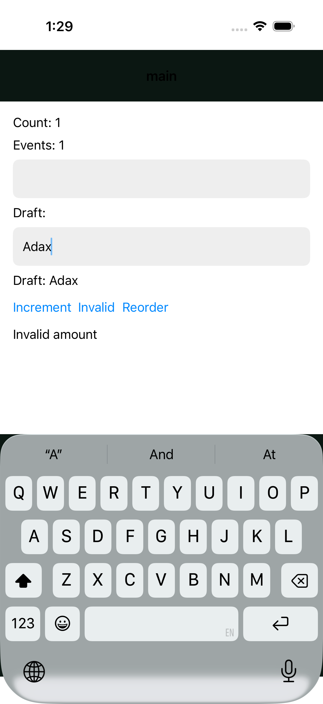

# Native HUD: retained protocol and iOS evidence

This is partial evidence for #2109, not completion of the RenderSurface or
game integration milestones. The model is a reactivity and subscription fixture,
not a simplified implementation of gameplay.

## Reproduce

```sh
bun test packages/stx/test/native/imported-hud.test.ts
bun scripts/native-portability-ios.ts \
  --craft-root /path/to/clean/craft \
  --simulator "$STX_TEST_SIMULATOR" \
  --appearance light --suite hud
```

Supply an owned, already booted disposable simulator. STX's runner uses the
supplied Craft SDK to generate a temporary native app. It does not edit Craft.
It requires exactly one passing XCTest with no failures or skips, and retains
the project, bundle, dependency hashes, compiler diagnostics and xcresult.

## Recorded run: 2026-10-23

The [receipt](native-hud-ios-2026-10-23.json) records the revisions, fixture
hashes and result. The tested production source was `35836c26da`, with the
HUD fixtures subsequently committed unchanged in `ef95fa0715`. These changes
are unreleased after v0.2.665. Craft was a clean checkout at
`f6929b7afce6b1a3b444f9b6b8c2b16b73dc681c`.

- Protocol: 2 tests passed, 0 failed, 54 assertions. Both normal and minified
  bundles execute two fresh mounts, edits, reordered controls and teardown.
- UIKit: 1 XCTest passed, 0 failed, 0 skipped, 45.847 seconds, on an arm64
  iPhone 17 Pro simulator running iOS 26.5 (23F77).
- Native text input and buttons render without a WebView. Imported-module
  state and subscription events update the displayed counters. Invalid input
  leaves the counters unchanged and displays the model's failure message.
- Reordering retains the edited field and its keyboard; continued typing
  updates the same row and visible echo. The protocol test also pins node ID.
- After protocol unmount, the subscription count is zero and further model
  mutations send no host messages. Native device teardown is not separately
  instrumented by this XCTest.



Screenshot inspection confirms Count/Events both 1, the retained `Adax` input
and matching echo, validation feedback and keyboard. This is not a general
style/appearance audit; the generated host navigation header is outside the
fixture's theme and has poor contrast in this capture.

## Remaining work and #2108 dependency

This fixture contains no graphics surface and does not prove HUD/surface
composition, Android output, actual game simulation agreement or the ts-css
HUD style acceptance in stacksjs/ts-css#39. Keep #2109 open.

Craft main was inspected at `a301dfd89103eb68b73c253dcb3914113ed26f7a`.
Its iOS, Android and TypeScript packages have no public RenderSurface contract
to compile or mount. craft-native/craft#409 remains open, with #406/#407/#408
as upstream dependencies. STX #2108 therefore remains open: mounting, resource
identity, interruption, teardown, unsupported-host behavior and native visual
output cannot be verified against a real shared surface contract yet. No
successful no-op surface or fabricated host global was added. Craft changes
belong to its assigned agent; STX integration follows that published contract.
