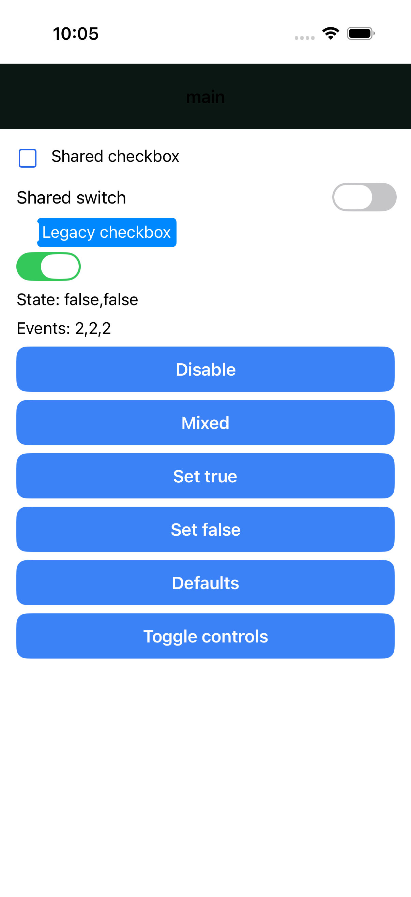
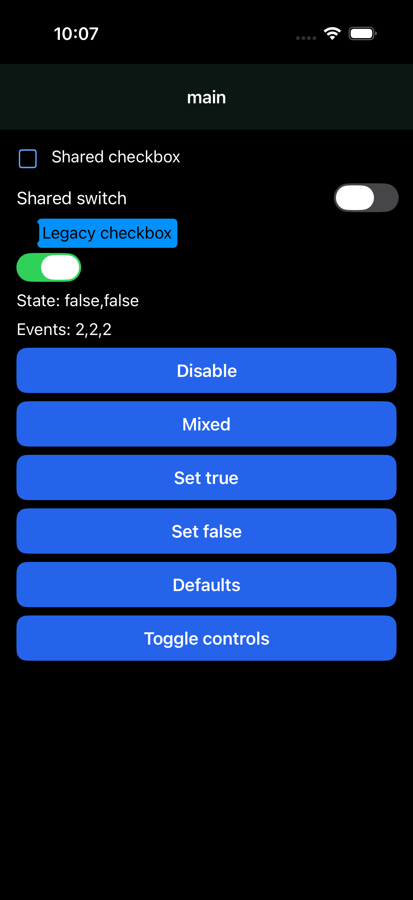

# Shared controls: maintained iOS host check

This is scoped evidence for #2090 and #2091, not completion of the native
portability audit. The fixture explicitly imports the real shared Button and
TextInput sources; it does not duplicate their implementation in a native test.

## Reproduce

From the STX checkout, compile the checked-in fixture (Bun required):

```sh
bun -e 'import {compileSharedScreenBundle} from "./packages/stx/src/native/compiler/bundle"; await compileSharedScreenBundle("packages/stx/test/native/fixtures/shared-controls-device.stx", {root:process.cwd(),outFile:"/tmp/stx-shared-controls.js",minify:true})'
bun test packages/stx/test/native/shared-controls-device-fixture.test.ts
```

From a clean Craft checkout with Xcode and xcodegen installed, supply that
bundle to its maintained harness. Set the simulator variable to an **owned,
booted disposable iOS simulator**; do not borrow another task's device.

```sh
CRAFT_NATIVE_RENDER_SIMULATOR="$STX_TEST_SIMULATOR" \
CRAFT_NATIVE_RENDER_BUNDLE=/tmp/stx-shared-controls.js \
CRAFT_ONLY_TESTING=NativeRenderUITests/NativeRenderUITests/testTypingAndButtonUpdatesDoNotDropTheKeyboard \
CRAFT_KEEP_NATIVE_RENDER_PROJECT=1 \
bun packages/ios/scripts/test-native-render.ts
```

The harness generates its app and tests in a temporary directory and reports
the retained project and `TestResults.xcresult` paths. No Craft source edits
are required. Check the result bundle, not only the harness's success message:
exactly one UI test should pass, with zero failures and skips. The harness's
generic message mentions unit tests, but this selection does **not** run them.

## Recorded run: 2026-10-22

- STX base: `c2ad7a459cfe4ac0774a641839fc40f9021701f3`, plus this fixture.
  Unreleased after v0.2.661.
- Craft: `45a33630e45b6ba84a43008ea3a36596f7287278`, clean checkout.
- Xcode 26.6 (17F113), iPhone 17 Pro simulator, iOS 26.5 (23F77), arm64.
- Fixture SHA-256:
  `7948c0e2465766798b77ca0604471743aa930ccddc4f7a1fc8f92a6767c59de0`.
- Minified bundle SHA-256:
  `e46a68336d01e08cf87ba39dae4dd1a250675395ea7a78e1497ce1cf7c4d1147`.
  Bundle hashes may vary with the checkout path or compiler version.
- Protocol fixture tests: 2 passed, 0 failed (normal and minified).
- XCTest: 1 passed, 0 failed, 0 skipped, 31.861 seconds.

The XCTest verifies a physical text field, absence of a WebView, typing `Ada`,
three button-driven counter updates, keyboard retention across those updates,
and continued typing through `Adaxxx`, including the reactive greeting label.
The protocol tests additionally verify selected shared-source dependencies,
retained input identity and no invalid mutation batches.

Screenshot inspection confirmed legible labels, a filled rounded shared Button,
a rounded shared TextInput, spacing, and the retained keyboard in dark appearance.
The initial fixture used a fixed white background and hid white labels in dark
mode despite passing accessibility assertions. It was corrected to paired
light/dark foreground/background utilities and the XCTest was rerun.

## What this does not prove

Craft's generated harness app sets `UIUserInterfaceStyle` to `Dark`, so changing
the simulator's appearance alone is **not** a light/dark transition test. No
light-mode or density-token visual validation is claimed here. Accessibility
queries are not a VoiceOver navigation audit. Android, overlay clipping/touch
routing, tabs, media playback, font scaling and broader component coverage
remain separate checks. Keep #2089, #2090 and #2091 open until their remaining
requirements have direct evidence.

## Shared overlay and tab device suite

STX also owns `fixtures/shared-overlays-device.stx` and
`fixtures/SharedPortabilityUITests.swift` under `packages/stx/test/native`.
The screen imports the real shared Button, Tooltip, Popover, Dialog, Drawer
and TabList/Tab sources. It exercises an anchored popup inside a clipping
ancestor, retained popup action state, a tooltip around a shared Button,
actually nested dialogs, a drawer, and tab selection.

Run this from STX against a clean Craft checkout and an owned booted simulator:

```sh
bun scripts/native-portability-ios.ts \
  --craft-root /path/to/craft \
  --simulator "$STX_TEST_SIMULATOR" \
  --appearance light
```

Use `--appearance dark` for dark appearance. This runner generates an app with
`appearance: 'system'` and selects the specified appearance on that simulator.
It retains its generated project, exact source/bundle hashes, compiler
diagnostics, Craft/STX revisions, XCTest result bundle and result summary.
The overlay suite requires four tests, all passing with no skips. It never
edits Craft source or boots/shuts down another task's simulator. These XCTest
checks run explicitly; the ordinary Bun suite runs the fixture's protocol
regression on both normal and minified bundles.

## Updated shared-controls acceptance: 2026-10-30

`--suite controls` now selects STX's own `SharedControlsUITests` against the
extended `shared-controls-device.stx` fixture. It imports the actual shared
Button, TextInput and Card; no alternative implementation is embedded in the
test app. Run both appearances:

```sh
bun scripts/native-portability-ios.ts --craft-root /path/to/clean/craft \
  --simulator "$STX_TEST_SIMULATOR" --appearance light --suite controls
bun scripts/native-portability-ios.ts --craft-root /path/to/clean/craft \
  --simulator "$STX_TEST_SIMULATOR" --appearance dark --suite controls
```

The controls selection requires exactly two passing tests with zero failures
and skips. The receipt includes the exact source/bundle hashes, revisions,
appearance, simulator and XCTest summary. The new fixture/test batch is
`7b3749e82e`, source after v0.2.745; the initial run's provenance records the
uncommitted fixture batch on top of `a11ce4930a`, before that batch was committed.

Validated with a clean Craft `b49aa1e894198d1b8b5fe7b07a6fa43d2d6d34f6`
snapshot, Xcode 26.6 and an owned iPhone 17 Pro / iOS 26.5 simulator:

| Check | Result |
| --- | --- |
| Light appearance: native input/keyboard and real Card layout | 2 passed, 0 failed/skipped |
| Dark appearance: same generated app and tests | 2 passed, 0 failed/skipped |
| Actual web fixture: typing, token updates and retained field/Card identity | 1 passed |
| Native protocol: iOS/Android, normal/minified | 4 passed |

The keyboard test types `Ada`, taps the shared Button three times, verifies
each counter update, retains the keyboard and continues typing to `Adaxxx`.
The density test measures the actual content inset at 24, 8 and 24 points as
the shared Button changes the Card's inherited control-spacing variable.
Protocol checks additionally verify radius changes (16/4/16), panel colors
across live appearance changes and retained native input/Card identity.
Web checks verify computed padding/radius and retained DOM input/Card identity.

Retained XCTest screenshots were inspected in both appearances: shared labels
are legible, controls remain distinct, and the Card changes from the light to
the authored dark panel color. This does not certify host navigation chrome,
Android device drawing, assistive-technology navigation or unsupported styles.
Ring/inset/offset and unsupported focus modes continue to produce diagnostics;
they are not approximated with borders or shadows. Craft source was untouched.

## Updated overlay gate: 2026-10-30

Craft #402 and #403 are closed upstream. The STX acceptance suite was rerun
against the clean Craft revision above rather than assuming their closure
made the complete suite pass. Popover clipping/actions/state, tabs and Tooltip
touch/outside dismissal passed in both light and dark appearance. Before the
DialogPanel fix, the suite was **3 passed / 1 failed**: opening a nested Dialog
did not expose its `open-inner` action. An isolated rerun reproduced the failure.

The fixture includes a `dialog-state` label in the failure hierarchy. It
reads `Dialog taps: 1; open: true`, proving the opening callback and parent
signal update ran. Existing modal/button assertions remain unchanged. The
protocol fixture also asserts that marker on opening and closing. At that
point #2089 remained open: passing the callback assertion alone did not
establish presentation.

The missing content was then isolated with a temporary raw-Modal probe: both
overFullScreen and pageSheet displayed an ordinary flow child on the same host.
Shared DialogPanel used an absolute-only wrapper, which did not produce usable
content in the sheet. Its native wrapper now uses a full-width/full-height
normal-flow box, preserving bottom alignment or explicit centered alignment.
The host can reparent and lay out that content inside its sheet controller.
Web markup and Craft source are unchanged.

The fix is `575fc90bea`, source after v0.2.745. The new structural assertions
failed in all four iOS/Android normal/minified
cases before the change. After it, the sheet/device-fixture/nested-close group
passes all 27 tests. The unchanged four-test iOS overlay suite now passes in
both light and dark appearance: **4 passed / 0 failed / 0 skipped per appearance**,
including actually nested dismissal and Drawer interaction. The dark run reused
the same generated app/tests with system appearance changed, rather than building
a second implementation. This supplies maintained iOS evidence for the shared
overlay contract; Android protocol coverage is not Android device certification.

## Historical overlay failures: 2026-10-22

The first light-appearance device run on Craft `45a33630` passed popup clipping
escape, real action taps, outside dismissal, state after reopening, and shared
tab selection. Two failures exposed additional work:

- A shared Button emits a click before the physical press bubbles. Tooltip
  toggled twice and remained closed. This was reproduced in the maintained
  STX protocol test by replacing its bare button with the actual shared file;
  the Tooltip now ignores that emitted duplicate when toggling native touch.
  Its dedicated iOS rerun passed (one test, zero failures, 15.653 seconds),
  verifying one action callback, visible hint and outside dismissal.
  A later dark-appearance run passed Popover and Tabs but lost the Tooltip
  Button action (`Help taps: 0`). This is a separate delivery failure after
  the STX fix; the differing appearances do not establish its cause. Nested
  host gesture arbitration still needs investigation and repeated device taps,
  tracked in [Craft #403](https://github.com/craft-native/craft/issues/403).
- A named native Dialog draws its button but hides it from accessibility
  queries. Craft makes the labelled Modal an accessibility leaf. This is
  filed as [Craft #402](https://github.com/craft-native/craft/issues/402).
  The device test retains the accessible name and its failing assertion so
  the host fix can be validated without weakening the acceptance check.

The nested-dialog fixture also exposed a separate STX close-event leak before
device execution: the outer Dialog/Drawer did not declare `close` until it
emitted it, so it accepted the inner component's close event. Both now declare
it during setup. `nested-overlay-close.test.ts` covers every Dialog/Drawer
combination on web/native, repeated inner dismissal, independent close counts
and teardown. Keep the broader issues open; the full device suite is not yet
green against this Craft revision.

## Shared Image acceptance: 2026-11-02

`--suite images` compiles `shared-image-device.stx` through normal per-call
resolution: presentation calls select the real shared Image, while legacy
`source` calls retain the primitive. The fixture also uses the actual shared
Button. STX owns the Swift tests; Craft only generates the temporary app.

```sh
bun scripts/native-portability-ios.ts --craft-root /path/to/clean/craft \
  --simulator "$STX_TEST_SIMULATOR" --appearance light --suite images
bun scripts/native-portability-ios.ts --craft-root /path/to/clean/craft \
  --simulator "$STX_TEST_SIMULATOR" --appearance dark --suite images
```

The gate requires **six passing tests**, with no failures or skips: four native
behavior/geometry tests, one actual-pixel test, and one UI interaction test.
Against clean Craft `1e141f1d3a02c9e5798cb3d816bcffc2d0d66d55` (source version
0.0.424), it currently exits nonzero: **5 passed / 1 failed / 0 skipped** in
each appearance. The sole failure is
`testRawHostPaintsOnlyItsFittedPixels`, tracked in [Craft #441](https://github.com/craft-native/craft/issues/441).
This is not a green all-platform or pixel-acceptance claim.

The run found and fixed two STX defects, unreleased after v0.2.784:

- A component scope with auto height sat between the fixed parent and the
  percentage-sized Image, collapsing its 100-point box to the decoded source's
  10-point intrinsic height. The Image's native fill-root marker now preserves
  its containing box through that scope. Browser output, other scopes and
  legacy Image selection retain their behavior.
- A remounted image reached the native loader with its retained old source
  before current parent props replayed. New images now wait through that
  microtask turn and combine initial source/style/handler patches with their
  creation. Existing-image updates keep their microtask schedule. Explicit
  flush, cancellation, object sources, clearing and runtimes without timers
  remain supported. An explicitly cleared source still forwards the host's
  missing-source error; valid remounts no longer add a false one.

Passing native checks verify the actual 100-point box, all five fit modes,
percentage and keyword positions, defaults, unchanged decoded CGImage and
UIImageView identities during geometry updates, source replacement/clearing,
hidden updates across separate host turns, fresh screens and teardown. The UI
test drives real shared Buttons and checks loads, retained bounds and remounts.
The same fixture passes iOS/Android normal/minified protocol execution.

Screenshot inspection then exposed a defect the frame checks missed. With no
STX involved, Craft's positioned UIImageView draws the original source behind
its correctly fitted child. For a 20x10 source in a 100x100 box, the fitted
child is correctly `(80, 90, 20, 10)`, but the actual red/blue pixels span
`(0, 26, 100, 74)`. A plain UIKit control paints only `(80, 90, 20, 10)`.
The test compares actual rasters and retains the failure rather than marking
it expected or weakening the assertion.

| Plain UIKit control | Existing Craft host |
| --- | --- |
|  |  |

[Source/bundle hashes, exact results and retained local result paths](shared-image-ios-2026-11-02.json).
The final native/components regression run passes **3,088 tests, zero failures**;
the focused new contracts pass **11 tests / 128 assertions**. Typecheck, lint
and formatting pass. The standalone XCTest pixel gate remains red under
Craft #441; ordinary Bun CI does not execute simulator XCTest.

#2091 stays open for that host defect and remaining Android/device/accessibility
acceptance. Craft source was untouched.

## Shared Video acceptance: 2026-11-02

```sh
bun scripts/native-portability-ios.ts --craft-root /path/to/clean/craft \
  --simulator "$STX_TEST_SIMULATOR" --appearance light --suite videos
bun scripts/native-portability-ios.ts --craft-root /path/to/clean/craft \
  --simulator "$STX_TEST_SIMULATOR" --appearance dark --suite videos
```

The maintained gate requires **five passes, no failures or skips**: four native
tests and one UI test. All five pass in light and dark appearances on an iPhone
17 Pro / iOS 26.5 simulator against clean Craft
`2140bc72e6033f0706312c6577819a5d97957d84` (source version 0.0.424).
The dark run uses the same build with system appearance changed.

The native tests generate local silent 64x32 H.264 clips using AVAssetWriter.
They verify actual playback time and AVPlayerLayer display readiness, live
controls/autoplay/muted flags, pause/resume events, loop changes at real media
end, null defaults, source replacement/clearing, legacy object-URI callers,
missing-file failures, recovery, fresh screens and teardown. Flag changes
preserve the physical view, controller, AVPlayer and current item. Source
replacement retains the view/controller and intentionally replaces the player;
conditional removal disposes its resources, with fresh ones on remount.
The UI test drives real shared Buttons and conditional views without a WebView;
it uses an empty source, so playback evidence comes from the native unit tests.

This found a real STX remount defect: the first Video creation carried its old
source/autoplay/loop values before current parent props replayed. The protocol
guard failed in all four iOS/Android normal/minified cases. The native regression
also failed against the original bundle: **five load starts instead of four**.
Initial media batching now covers Video as well as Image, allowing prop replay
to settle and combining initial source/style/handler updates into creation.
Already-mounted updates keep their ordinary microtask schedule. Craft is unchanged.

An initial exploratory run had two fixture mistakes: a null-valued diagnostic
label expected literal `null` instead of empty interpolation, and a pause-event
assertion ran before its asynchronous callback. Explicit String conversion and
waiting for that event correct the fixture; the final pause assertion remains.
The strengthened remount test then failed on the old bundle and passed with
the fix. No timeout, native assertion or release gate was relaxed.

The final native/components cohort passes **3,092 tests / zero failures**;
focused Video and initial-media contracts pass **10 tests / 104 assertions**.
Typecheck, lint and formatting pass. The two existing browser custom-element
selector diagnostics remain visible and are pinned exactly by the protocol test.
[Hashes, before/after counts and retained result paths](shared-video-ios-2026-11-02.json).

This is unreleased source after **0.2.784**. It does not certify physical devices,
Android playback, provider streams/embeds, DRM, PiP/background interruption,
audio mixing, accessibility or pixel parity. Keep the broader #2091 open.

## Shared toggle acceptance: 2026-11-02

```sh
bun scripts/native-portability-ios.ts --craft-root /path/to/clean/craft \
  --simulator "$STX_TEST_SIMULATOR" --appearance light --suite toggles
```

Repeat with `--appearance dark`. The gate requires **five passing tests, zero
failures/skips**: three native unit tests and two actual-tap UI tests. The fixture
uses normal resolution for shared checked/change calls and legacy
value/value-change calls together. Its dependency guard checks all four real
component files in iOS/Android normal/minified bundles.

The native checks exercise the real UIButton checkbox and UISwitch: live
checked/disabled/mixed state, mixed-glyph changes, defaults, stable native-view
identity during updates, boolean shared events versus object legacy events,
retained legacy state without parent writeback, hidden updates, repeated
remounts, fresh screens and disposal. UI tests tap the actual controls, verify
disabled touches emit nothing, and check exact event counts without a WebView.

This found an STX defect: clearing the shared Switch model sent a null native
value, which means uncontrolled retention to the host. An on switch therefore
stayed on while the browser and parent model indicated off. The shared native
binding now explicitly sends its boolean state, including false on reset.
Legacy primitives and Craft remain unchanged. The four protocol cases failed
before the fix; the original native remount case also retained `1` instead of `0`.

The native tests compare UISwitch accessibility traits to an ordinary UIKit
switch instead of assuming a disabled trait bit that UIKit does not expose
through that getter. UI enabled polling reads `element.isEnabled` directly;
there is no extra diagnostic label or runtime workaround. Screenshot review
also caught poor contrast in the fixture; explicit paired colors now keep its
labels readable in both appearances. Native navigation chrome is outside this
component fixture's acceptance.

Against clean Craft `c7984f088be396f9b2c9bedab4a7d0a64e3fab4e`, all five
checks pass in both light and dark on iPhone 17 Pro / iOS 26.5 Simulator, with
zero failures or skips. The same build is used in both appearances.

The final native/components cohort passes **3,098 tests / zero failures**.
Focused browser/native/legacy checks pass **21 tests / 356 assertions**. The
template snapshot was updated for the reviewed native binding change; the
earlier backend-shutdown timeout passed unchanged on retry. Both affected full
files pass **12 tests / 50 assertions**, without changing a deadline.
[Exact results, hashes and remaining limits](shared-toggles-ios-2026-11-02.json).

| Light fixture | Dark fixture |
| --- | --- |
|  |  |

This is unreleased source after **0.2.784**. Keep #2091 open: iOS Simulator
checks do not certify Android/physical-device drawing, VoiceOver/TalkBack,
keyboard navigation, broad pixel parity or native navigation chrome.

## Shared accessibility acceptance: 2026-11-13

What a screen reader is told about the shared Button, TextInput, Checkbox and
Switch, for [#2184](https://github.com/stacksjs/stx/issues/2184). XCUITest
reads the accessibility tree VoiceOver reads, so `--suite accessibility`
asserts what would be announced rather than what was passed down as a prop:

- **Role and name.** Each control is one element of the right kind, under the
  name a reader hears. An icon button whose only name is a bound `ariaLabel`
  is announced by it.
- **State.** The bound name follows its signal, a disabled button is not
  announced as usable, a switch reports 0 then 1, a checked box differs from an
  unchecked one, and a text field reports what was typed.
- **Order.** Every control is exposed once, and top to bottom they are in the
  order the screen was written.
- **Apple's audit.** `performAccessibilityAudit()` runs every audit type.

iPhone 17 Pro / iOS 26.5 Simulator against clean Craft `da313f8b59d6`:
**4 passed / 0 failed / 0 skipped in dark, and 4 / 0 / 0 in light.** An
earlier pass against `c8ba180d921d` gave the same results and findings.

Everything the audit checks about what a reader is told came back clean. What
it found is about drawing, and the test lists it per appearance so that a new
finding fails and a fixed one has to come off the list:

| Appearance | Finding | Where |
| --- | --- | --- |
| Dark | Contrast nearly passed | The shared TextInput's placeholder on its fill ([#2187](https://github.com/stacksjs/stx/issues/2187)) |
| Both | Text may clip at larger Dynamic Type sizes | The shared TextInput, fixed at 48 points ([#2187](https://github.com/stacksjs/stx/issues/2187)) |
| Light | Contrast failed | The host's navigation title ("main"), not a shared component ([craft#531](https://github.com/craft-native/craft/issues/531)) |

This is not VoiceOver speaking, which a simulator cannot run, and it says
nothing about Android, TalkBack or a physical device: the machine that ran it
has no Android SDK. Image and Video are not in this suite.
[Exact results, hashes and limits](shared-accessibility-ios-2026-11-13.json).

## iOS acceptance, all of it: 2026-11-14

[#2184](https://github.com/stacksjs/stx/issues/2184) was narrowed on
2026-11-13 to iOS: Android, on an emulator or a phone, is out of scope for it.
What follows is every iOS check that issue asked for, what running them found,
and what is left with the reason it is left.

### What the runs found, and what changed

Each of these was seen on the simulator before it was fixed, and each has a
protocol test in `packages/stx/test/native` beside the device suite that
watches it.

| Seen on the simulator | Now | Commit |
| --- | --- | --- |
| A field under the label "Full name" was announced by its placeholder, and a Select by the option it held: a `<label for>` named nothing on a host | The label's words name the control, and the label is read once | `0af3ba98a8` |
| A decorative image was a stop for VoiceOver, announced as "image" | `aria-hidden` reaches the host | `0af3ba98a8` |
| Typing into a `PasswordInput` bound with `v-model:value` left the page's signal empty | It binds both ways, as the other fields do | `0af3ba98a8` |
| The Pager was one stop called "Tour", its pages and dots out of reach; an open Drawer was one stop with its close button inside | A box that names a group of controls keeps the name as ARIA and does not send it | `f6131a4180` |
| The page a pager was on was not said to be the current one | `aria-current` is announced as selected | `f6131a4180` |
| A Tooltip's words reached nobody who could not see them appear | They are the trigger's hint | `f6131a4180` |
| A list row's title was drawn a space in, and read as " Second " | Template indentation is not text | `f6131a4180` |
| At the largest text size a Button's label stuck out of its fill and a field cut its words in half | Their heights are floors | `db5911e80e` |
| A row of filter chips vanished on a screen taller than the phone | It does not shrink | `8e10f1e5a0` |
| An app had no way to name a group of its own controls and keep them reachable | `role="list"` is that group | `8e10f1e5a0` |

### The suites

```sh
bun scripts/native-portability-ios.ts --craft-root /path/to/clean/craft \
  --simulator "$STX_TEST_SIMULATOR" --appearance dark --suite forms
```

| Suite | Tests | What it holds |
| --- | --- | --- |
| `controls` | 3 UI | Typing keeps the keyboard through updates; a Card's inset follows its density token |
| `overlays` | 4 UI, 2 in-app | Popover, Tooltip, nested Dialog, Drawer and Tabs take touches; a reader hears the tooltip's hint and the chosen tab, and is inside an open dialog or drawer |
| `images` | 1 UI, 6 in-app | Fit, position, replacement and the pixels actually painted |
| `videos` | 1 UI, 4 in-app | A local clip plays, pauses, loops, is replaced and removed |
| `streams` | 1 UI, 3 in-app | A file over HTTP and an HLS stream play; a missing stream is an error the page hears, and the player recovers |
| `toggles` | 2 UI, 3 in-app | Checkbox and Switch state, events and disabled touches |
| `accessibility` | 4 UI | Role, name, state and order of Button, TextInput, Checkbox and Switch; the system audit |
| `forms` | 4 UI, 2 in-app | Every field named by its label; typing, revealing and choosing reach the page; the last field stays above the keyboard; keyboard and autofill set-up; the system audit |
| `lists` | 3 UI, 2 in-app | Rows, filters, a named list and the Pager as a reader reaches them; the system audit |
| `text-size` | 1 UI, 1 in-app | At the largest accessibility size no word is cut off and every control can be scrolled to and used |
| `hud` | 1 UI | The host's own HUD panel, not a shared component |

`SpokenStops.swift` is what the in-app tests read a screen with. XCUITest
lists every view that has an identifier whether or not a reader can reach it,
so it cannot say that a decorative image is skipped or that a drawer's close
button is out of reach. `SpokenStops` walks the views the way UIKit hands them
to VoiceOver and lists the stops in order, as `name | value | what it is`.

The gate also takes the settings a person can change. Each is recorded in the
run's `provenance.json` with the device and its iOS version.

| Flag | What it does |
| --- | --- |
| `--content-size` | Sets the simulator's text size for the run (`text-size` sets the largest by itself) |
| `--orientation landscape` | Generates an app that turns, and holds the device sideways |
| `--direction rtl` | Switches on the system's right-to-left pseudolanguage |
| `--increase-contrast` | Switches on Increase Contrast |

The lists of known audit findings in the suites were written against an
iPhone 17 Pro held upright. On that phone a listed finding must still be
found, so a fixed one has to come off the list. Any other run is told it is
not the reference, and there the audit may only find what is listed: it reads
what is on the screen, and a smaller screen shows less.

### Recorded runs

Xcode 26.6, iOS 26.5 Simulator, clean Craft `7580fcc387d3` (a clone of the
checkout's HEAD; the checkout itself had another task's edits in it), stx
`b851c28431` (and `d3dcb39071`, which changes one unit test). [Every run's counts, device and settings](shared-ios-acceptance-2026-11-14.json).

| Device and setting | Appearance | Passed | Not passing |
| --- | --- | --- | --- |
| iPhone 17 Pro, upright | dark and light | 21 of 22 runs, 95 of 96 tests | `overlays` dark: 5 of 6 |
| iPhone 17 Pro, upright, run again alone | dark and light | 3 of 3 runs, 18 of 18 tests | None |
| iPhone 17 Pro, right-to-left | dark | 7 of 7 runs, 31 of 31 tests | None |
| iPhone 17 Pro, Increase Contrast | dark and light | 12 of 12 runs, 58 of 58 tests | None |
| iPad (A16) | dark | 11 of 11 runs, 48 of 48 tests | None |
| iPhone SE (3rd generation) | dark | 9 of 11 runs, 46 of 48 tests | `forms` dark: 5 of 6; `hud` dark: 0 of 1 |
| iPhone SE (3rd generation), run again | dark | 1 of 1 runs, 6 of 6 tests | None |
| iPhone 17 Pro, landscape | dark | 0 of 3 runs, 12 of 15 tests | `lists` dark: 4 of 5; `forms` dark: 5 of 6; `accessibility` dark: 3 of 4 |

The four lines that are not clean:

- **`overlays` dark on the reference phone, 5 of 6.** One popover test timed
  out while three simulators were building at once. Run again by itself it
  passes 6 of 6, and it passed in every other setting above.
- **`forms` on the iPhone SE, 5 of 6.** The audit reported a second
  placeholder too long for one line in the narrower field. It is listed now
  as something only a narrower phone brings out, and the run after that
  passes 6 of 6.
- **`hud` on the iPhone SE.** See the last entry under what is left.
- **Landscape.** See below: the host does not scroll there.

### What is the host's

Six findings are in Craft's iOS host rather than in stx. Each is pinned in the
suite that met it, as it is today, so the suite fails when the host changes
and the pin has to be turned into the real expectation.

| Finding | Craft issue | Pinned in |
| --- | --- | --- |
| The navigation title fails contrast in light appearance | [#531](https://github.com/craft-native/craft/issues/531) | `SharedAccessibilityUITests` known list |
| A dialog's name stays on the node it was opened from and never reaches the sheet | [#535](https://github.com/craft-native/craft/issues/535) | `SharedOverlaysNativeTests` |
| A labelled view is one stop even when it holds controls | [#536](https://github.com/craft-native/craft/issues/536) | stx withholds the label (`READER_GROUP`) |
| A Picker's words are scaled for text size twice | [#537](https://github.com/craft-native/craft/issues/537) | `SharedTextSizeNativeTests` |
| A scroll view does not scroll on a phone launched in landscape | [#539](https://github.com/craft-native/craft/issues/539) | Not pinned: see landscape below |
| A TextInput's placeholder is inset by its padding twice | [#540](https://github.com/craft-native/craft/issues/540) | Not pinned: 16 points of drawing |

### What is left, and why

- **Landscape on a phone.** `--orientation landscape` works and the suites
  are written to run in it, but everything below the fold is out of reach
  there until craft#539 is fixed, which is most of every screen at 402 points
  tall. Recorded as it is: `lists` 4 of 5, `forms` 5 of 6 and `accessibility` 3 of 4, each failure a control that is below the fold or a pager that will not turn its page.
- **Right-to-left mirroring.** Every suite passes with the system's
  right-to-left switch on, which is to say every control still works. The
  drawing is half mirrored: text aligns right and the system's own controls
  flip, while rows keep their order and a chevron stays on the right. Layout
  direction is not something the host has, and the shared components position
  with physical sides as they do on the web, so this is recorded and not
  asserted.
- **VoiceOver speaking.** A simulator cannot run VoiceOver. `SpokenStops` and
  XCUITest check what it is handed, which is everything it reads from, not the
  sentence it composes.
- **A physical iPhone.** Not run. It needs the phone unlocked, a development
  team to sign with and the gate taught to target a device; nothing in these
  suites is simulator-specific except how the appearance and text size are
  set.
- **Picture in picture, background audio, interruption, DRM, provider
  embeds.** The shared Video does not offer them: the host turns picture in
  picture off and no prop turns it on (pinned in `streams`), and it adds no
  audio-session or interruption handling of its own, so those are AVPlayer's
  defaults. There is nothing of stx's to accept.
- **Pixel parity with the browser.** Not a goal, by design. On a host the
  shared Button, fields, Select, Checkbox, Switch and lists draw the
  platform's control (their `$native` branch: a 48-point filled field where
  the browser draws a ringed one), so a pixel comparison would compare two
  designs. What is held instead is geometry measured in the app (`images`,
  `controls`, `text-size`) and the system's audit of contrast and clipping.
- **The placeholder grey and the secondary greys.** The audit reports the
  field placeholder on its dark fill and a row's value and time on white.
  Those are colour decisions and stay with
  [#2187](https://github.com/stacksjs/stx/issues/2187); the clipping that
  issue also described is fixed.
- **The `hud` suite on a small iPhone.** Its buttons sit under the keyboard
  on a 667-point screen. It is the host's panel and a fixture's layout, not a
  shared component.
